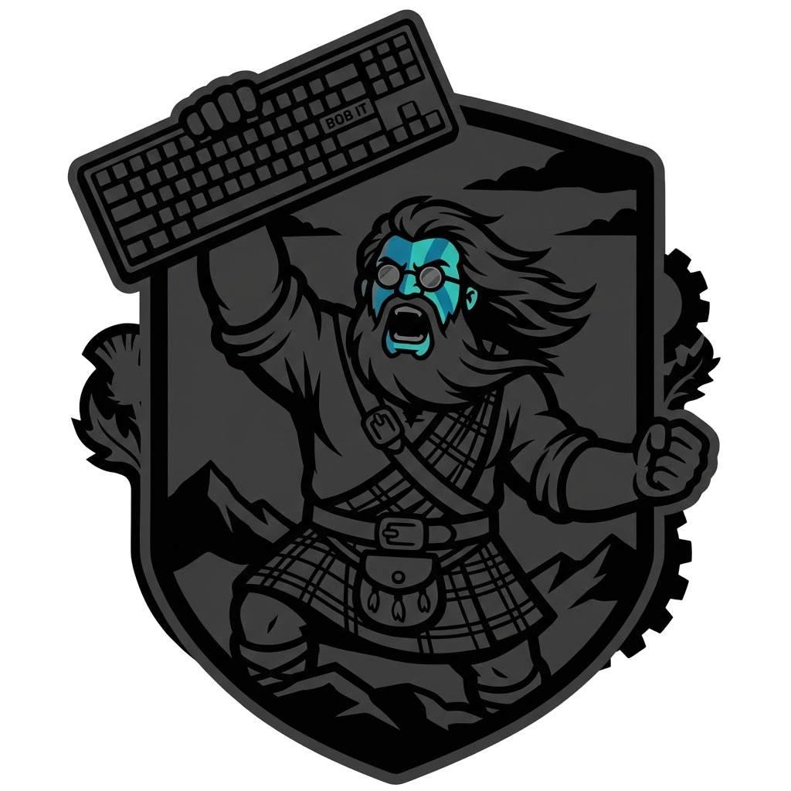

  

<h1 align="center">BoB</h1>

<strong>Build · Orchestrate · Bind</strong> — a <a href="https://canopyseeds.com">Canopy Seed</a> project.

<em>Own your AI. BoB does the rest.</em>

---

BoB is an always-on team of AI agents that you own. It runs on **your** machine,
under **your** logins and keys. It sends each piece of work to the model that suits it,
can have a second model review what the first one built, remembers what it learns, and
lets you set how much it may do to your files, your PC and the network without asking.

> **v0.99.1 — Windows app preview.** New in this release: a Windows installer, a desktop
> app with seven agents, sign-in for ChatGPT and Claude subscriptions from inside the app,
> and a Builder whose freedom you set. **Workflows are a preview:**
> a run may stop before it finishes. Reaching BoB from Discord and from a phone is next.
> This is an honest early release; read `SECURITY.md` before exposing the gateway.

## Why BoB

The most capable models live behind someone else's login, and that access can change
under you: new gates, price changes, regional restrictions, waitlists. Renting an
intelligence is not the same as owning your workflow. **BoB is the opposite bet:**
your machine, your credentials, your data. Nobody can revoke it, because there is no
one in the middle.

What BoB adds comes after "just call an LLM":

- **Sovereignty.** Every model is reached with your own key or your own subscription
  sign-in. BoB never proxies, resells or shares anyone's access. (See `COMPLIANCE.md`.)
- **Verification.** A workflow has its own review and fix stages, so what one model
  builds is checked by another before it reaches you. *(Workflows are a preview.)* The
  Builder works in an isolated worker whose network access is limited to an allowlist.
- **Orchestration.** A request can go to a single agent, or run as a staged job in which
  different agents, on different models, plan, build, review and fix.
- **Always on.** BoB is a service, not a chat window. Its memory, projects and running
  work carry on between conversations. On a server it runs around the clock; on a Windows
  PC it runs while the desktop app is open.
- **Your rules.** You choose how much freedom the Builder has: it proposes changes for
  you to apply (Suggest), asks before each change (Approve), or makes ordinary edits and
  runs ordinary commands on its own (Auto). A fourth mode with no questions exists; it
  has to be confirmed and switches itself off after a while. Reaching into your Windows
  PC needs a grant from you first.

## Work at the level that fits the job

Some work wants a conversation. Some wants a crew you can walk away from. BoB lets you
pick the level for each piece of work, and move between them.

| Level | What you do | What BoB does |
| --- | --- | --- |
| **Talk to one agent** | Open a conversation with the Assistant, Planner, Researcher, Builder, Reviewer, Fixer or Orchestrator, and choose the provider and model for it. | Answers on that model, with your memory and projects in reach. |
| **Hand a job to a crew** | Describe the outcome and start a workflow from the Library. | Runs plan, build, review and fix as separate stages, each with its own agent and model. *(Preview.)* |
| **Leave it running** | Start the work and do something else. | Carries on in the background and collects anything that needs a decision under **Needs you**. *(Preview. Work you put on the calendar shows as due with a Run button; it does not start by itself yet.)* |
| **Drive it from another agent** | Point an MCP-capable agent, such as Claude Code or Codex, at BoB. | Offers its agents and memory to that agent as tools, within the access you granted. *(From-source installs today.)* |

## A library that grows with you

BoB is meant to get more capable the longer you use it. The **Library** is your
inventory of apps, workflows and tools. Save a workflow that worked, sketch a new one on
a canvas, keep an app BoB built for you. Each thing you add is something you can run
again, change, or build the next thing on.

## Install

There are three ways in. The installer is the quickest on a Windows PC. Docker and
from source are for a home server, and for anyone who wants to work on BoB itself.

### Windows installer (preview)

You need 64-bit Windows 10 (version 2004 or later) or Windows 11, about 20 GB of free
disk space, an administrator account for the install, and an authenticator app on your
phone.

1. Download `BoB_0.99.1_x64-setup.exe` from
   [Releases](https://github.com/tyoung515-svg/bob/releases) and run it. The installer is
   not signed yet, so Windows shows "Windows protected your PC"; choose **More info**, then
   **Run anyway**.
2. Open BoB and choose **Set up Bob on this PC**. BoB installs its runtime into its own
   WSL 2 distribution. If WSL is not installed, setup shows the three steps to add it;
   that needs one restart. Docker Desktop is not required.
3. Create your lane: a name and a password of at least 10 characters. A lane is one
   person's private space, with its own login, conversations, memory and workspace.
4. Scan the QR code with your authenticator app. BoB asks for a code when you sign in
   and when you change your password or security settings.
5. Optionally install the local embedder (about 0.6 GB), which lets BoB find memories by
   meaning.
6. Connect a model, as described below, and start a conversation.

To update later, run the newer installer over the one you have, open BoB and press
**Upgrade** on the **BoB update available** card. BoB saves a backup of its runtime first
and keeps your lane, memory and sign-ins.

### Docker or from source

Follow **[`AGENTS-SETUP.md`](AGENTS-SETUP.md)**. It covers the datastores, the database
migrations, secrets, your lane, a model backend and first sign-in, and an AI agent can run
it for you. Upgrading an existing install is a separate runbook:
**[`UPGRADE.md`](UPGRADE.md)**.

## Connect a model

BoB needs at least one model. In the desktop app, use first-run setup or
**Settings → Keys & sign-ins**.

| How | Providers | What happens |
| --- | --- | --- |
| **Claude subscription** | Claude | You sign in on Anthropic's own page. BoB then runs Anthropic's own Claude Code program, unmodified, under your login. |
| **ChatGPT subscription** | ChatGPT | You sign in on OpenAI's own page, through OpenAI's Codex program. BoB then sends your turns to OpenAI's Codex service with that sign-in. |
| **API key** | OpenAI, Anthropic, DeepSeek, Google, GLM (Z.ai), Kimi (Moonshot), Qwen (Alibaba Model Studio) | You paste a key. It is stored in your lane on your machine. |
| **Local models** | Ollama, LM Studio, llama.cpp | Available on from-source installs. |

Each provider has a default model. In any conversation you can pick **Provider**, then
**Model**, for the next turn.

## What's inside

| Part | Role |
| --- | --- |
| Desktop app | The window you work in: agents, workspace, tasks, projects, memory, library, and the things that need your decision. |
| `bobclaw-core` | The engine: agents, routing, workflows, memory and all model backends. |
| `bobclaw-gateway` | Login (password and authenticator), chat, and the REST and WebSocket API. |
| Broker and workers | Carry requests between the app and the runtime, and run Builder work in isolation with a network allowlist. |
| Runtime image | Everything above, with Postgres, Redis, Qdrant and a local embedder, packaged as one WSL distribution for the installer. |
| `bobclaw-tui`, `bobclaw-telegram` | A terminal front end and a Telegram front end, for from-source installs. |
| `bobclaw-app` | The earlier Kotlin desktop and Android app. It does not work with this release and is kept until the mobile app is rebuilt. |

## Status and scope

**Works in this release:** the installer and first-run setup; seven agents with several
conversations at once; ChatGPT and Claude sign-in and API keys; choosing a model per
conversation; Builder writes and commands with approvals; memory with a local embedder;
projects, tasks and the library.

**Preview:** workflows and unattended runs.

**Not yet:** scheduled work that starts by itself, a Discord link, a phone app, a signed
installer, and desktop apps for macOS and Linux.

BoB is for one owner per install. Lanes keep each person's conversations, memory and
workspace apart, and code that a model runs in one lane cannot read another lane's files
or sign-ins. The services behind the lanes share one database, though, so lanes are not a
wall between people who do not trust each other. BoB listens on loopback only by default
and is not a hardened multi-tenant public service; see `SECURITY.md` before changing
that. This build ships with generous limits, so that a job can finish. You can tighten
them yourself.

## Roadmap to 1.0

- **Next small releases:** a Discord link, so you can reach BoB away from your PC; more of
  the preview features switched on as they prove themselves.
- **1.0:** workflows out of preview, scheduled work that starts by itself, a signed
  installer, and BoB staying up on Windows without the app window.
- **After 1.0:** a mobile app.

## Documentation

- **[`AGENTS-SETUP.md`](AGENTS-SETUP.md)** — Docker and from-source install, step by step or run by an agent
- **[`UPGRADE.md`](UPGRADE.md)** — upgrading an existing Docker or from-source install
- **[`ARCHITECTURE.md`](ARCHITECTURE.md)** — services and the operating model
- **[`SECURITY.md`](SECURITY.md)** — the loopback-by-default posture; read before exposing anything
- **[`COMPLIANCE.md`](COMPLIANCE.md)** — using your own subscriptions and keys within each vendor's terms
- **[`CONTRIBUTING.md`](CONTRIBUTING.md)** — running the tests, project layout
- **[`CHANGELOG.md`](CHANGELOG.md)** — release notes

## License

[Apache-2.0](LICENSE). A [Canopy Seed](https://canopyseeds.com) project.
